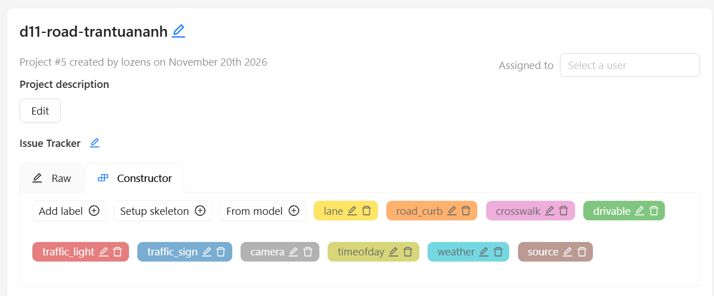
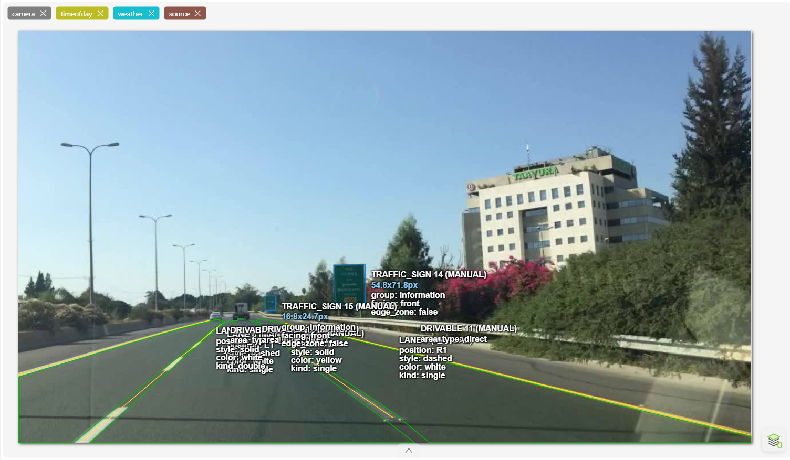
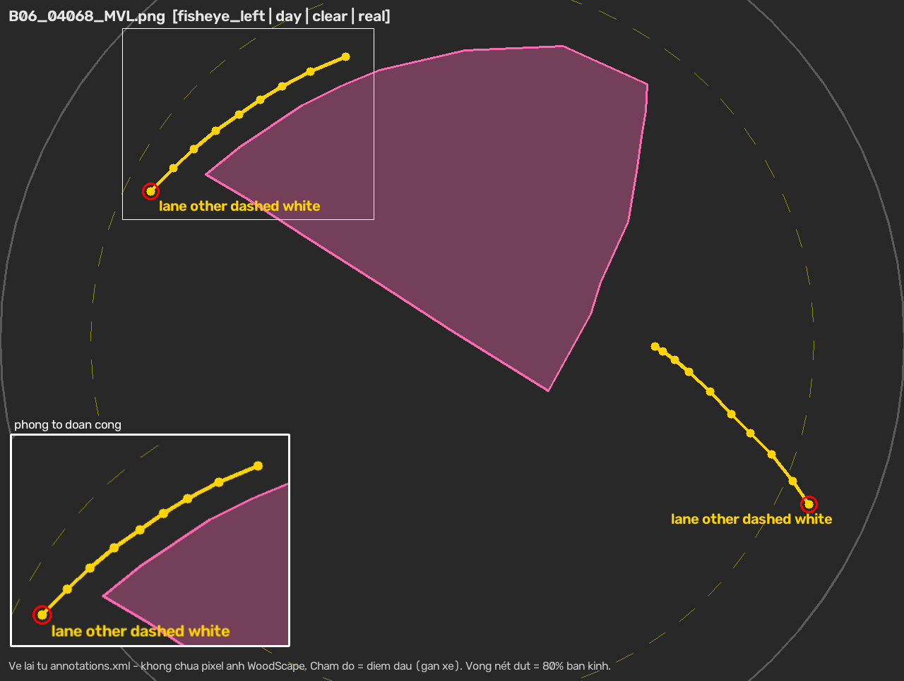

# Báo cáo cá nhân — Ngày 11
Họ tên: Trần Tuấn Anh      Mã học viên: 2A202603230  
Phiên bản CVAT (Help → About): v2.74.1 (CVAT chạy local bằng Docker, theo hướng dẫn coach)  
Guideline: Road v1.0    Lần nộp (`revision`): 1 (coach cho nộp 4 file, không kèm manifest)  
Thời điểm export (ngày giờ trên CVAT): front 20/11/2026 20:42 · fisheye 20/11/2026 19:14 (UTC+7)    Số lần sửa sau Rework (tự kiểm): 1  

## 1. Kiểm project
| Mục | Đúng như guideline Road v1.0? | Ghi chú |
| --- | --- | --- |
| 6 label, đúng kiểu | Đúng | lane, road_curb (polyline); crosswalk, drivable (polygon); traffic_light, traffic_sign (rectangle). Dán vào tab Labels → Raw từ `configs/road_v1_labels.json`, so lại với `python -m road_lab.taxonomy` |
| Thuộc tính và giá trị | Đúng | lane: position/style/color/kind; drivable: area_type; traffic_light: color/type/facing + edge_zone (checkbox); traffic_sign: group/facing + edge_zone. Đã đối chiếu từng giá trị trong phần `<meta>` của file export |
| 4 tag ảnh | Đúng | camera, timeofday, weather, source: mỗi tag là label kiểu Tag, có một thuộc tính select `value` |

Cách kết thúc polyline trên bản CVAT này: click các điểm từ gần xe ra xa, bấm phím **N** để kết thúc. Sau đó mở Details để sửa thuộc tính, vì polyline mới luôn mang mặc định `L1 / solid / white / single`.  
Cách đặt tag ảnh trên bản CVAT này: công cụ **Setup tag** ở thanh bên trái → chọn label (camera trước tiên) → bấm **Tag**. Giá trị `value` sửa trong bảng Objects → Details, vì CVAT tự điền giá trị đầu danh sách (ví dụ `weather = clear`).

## 2. Số lượng đã gán
| Task | Ảnh | lane | road_curb | crosswalk | drivable | traffic_light | traffic_sign |
| --- | ---: | ---: | ---: | ---: | ---: | ---: | ---: |
| front | 12 | 31 | 2 | 12 | 25 | 43 | 63 |
| front-extra (đã làm 0 / 4) | 0 | – | – | – | – | – | – |
| fisheye | 8 | 10 | 3 | 7 | 5 | 8 | 6 |
| fisheye-extra (đã làm 0 / 4) | 0 | – | – | – | – | – | – |

## 3. Bảng ca khó
| Ảnh | Nhãn | Phân vân giữa | Đã chọn | Lý do |
| --- | --- | --- | --- | --- |
| A01 | lane L2 (vạch trắng ngoài cùng trái) | `single` / `double` | `double` | Phóng to đoạn gần xe thấy hai nét song song có khe tối; lên xa hai nét nhòe thành một. Polyline đặt giữa hai nét |
| A04 | lane L1 (vạch vàng giữa đường) | `dashed single` / `solid double` | `solid / yellow / double` | Hai nét vàng liền song song (vạch tim đường hai chiều). Phía bên kia vạch là làn ngược chiều nên **không** gán `alternative` |
| A04, A05, A07, A08 | tag weather | `clear` / `overcast` | `overcast` | Trời xám đặc, không thấy nắng, mặt đường khô (guideline: âm u, nhiều mây nhưng khô) |
| A05 | lane L1, R1 | vẽ vạch / không vẽ | không vẽ (coach đã xác nhận miễn QC1-02) | Đường không có vạch sơn. Gán `road_curb` cho vỉa hè phải. `direct` bỏ hai dải xe đỗ sát lề theo guideline |
| A07 | lane L1 | vẽ theo chân dải phân cách / không vẽ | không vẽ (coach miễn) | Bên trái là dải phân cách bê tông, không có vạch sơn |
| A08 | lane L1, R1 | vạch liền mép phải là R1 / vạch đứt giữa là R1 | R1 = vạch trắng đứt giữa, R2 = vạch liền mép phải; L1 không vẽ (coach miễn) | Xe đi bên trái vạch đứt. Hai vạch trắng xa bên trái thuộc các làn ngoài, không sát làn mình. Vạch ngang dài ở y≈360 là vạch dừng, không gán lane |
| A09 | lane R1 | vẽ / dùng road_curb | `road_curb` (coach miễn QC1-02) | Bên phải là bó vỉa, không có vạch sơn |
| A09 | đường cong trắng quanh đảo bên trái | `road_curb` / lane L2 | lane L2 `solid white double` | Là vạch sơn (hai nét), không phải mép bó vỉa |
| A12 | lane R1 | vẽ / không vẽ | không vẽ (coach miễn) | Bên phải là làn xe đỗ, không có vạch |
| A10 | box "đèn" trên nóc xe cứu thương | traffic_light / không gán | không gán | Là đèn ưu tiên của xe, không phải đèn tín hiệu giao thông |
| A03 | bảng "OPEN", logo hãng xe | traffic_sign / không gán | không gán | Biển của cửa hàng, không phải biển giao thông |
| A12 | đèn hình người đi bộ | `vehicle` / `pedestrian`; màu | `pedestrian`, `green`, `front` | Đèn hình người đang sáng (được đi) quay về phía xe |
| A07, A04 | biển nhìn thấy mặt sau | group | `facing = back`, `group = other` | Không đọc được mặt biển nên không xếp được nhóm theo chức năng |
| A03, A04, A07, A08, A09, A10, A11 | một số biển nhỏ, mờ | group | `other` | Quá nhỏ hoặc mờ, không đọc được nội dung; giữ box vì cao ≥ 8 px |
| B02 | lane L1/R1 | vẽ / không vẽ | không vẽ | Xe đứng giữa giao lộ, phía trước chỉ có ngựa vằn, không có vạch làn |
| B03 | vệt mảnh tối giữa làn | lane L1 / không gán | không gán | Phóng to thấy là mạch nhựa/vết nứt, không phải sơn trắng |
| B04 | làn BUS bên trái | `alternative` / không gán | không gán | Làn dành riêng cho xe buýt, xe mình không đi được |
| B04 | đèn đi bộ (1062,240) | `edge_zone` | tắt | Tâm hộp cách tâm ảnh ≈ 497 px < 512 px (80 % bán kính) — sát ngưỡng, đã đo lại toạ độ |
| B03 | biển (r ≈ 487 px), đèn (r ≈ 472 px) | `edge_zone` | tắt | Tâm hộp nằm trong 80 % bán kính |

## 4. Phiếu QC 1 nhận được
Bạn kiểm lô của tôi: không có bạn đổi lô (làm CVAT local cá nhân theo hướng dẫn coach), nên tôi **tự kiểm** 6 ảnh (A04, A08, A09, A10, A12, B04) của bản export đầu tiên theo đúng mẫu phiếu. Xem `trantuananh-qc1-for-trantuananh.md`.  Quyết định nhận được: **Rework** (6 lỗi nặng; lỗi chính 24 / 138 nhãn = 17,4 % > 5 %)
| Mã lỗi | Số lỗi | Đồng ý? | Đã sửa? |
| --- | ---: | --- | --- |
| QC1-01 (tag weather, nhẹ) | 2 | Đồng ý | Đã sửa: A04, A08 → overcast |
| QC1-02 | 1 | Đồng ý | Đã sửa: A08 thêm R1 (vạch đứt giữa) |
| QC1-03 | 4 | Đồng ý | Đã sửa: A04 gộp mẩu R2 vào R1; A08 R1 → R2; A09 đoạn "L2" gộp vào L1; A12 xóa lane thừa |
| QC1-04 | 2 | Đồng ý | Đã sửa: A04 thêm R2 làn xe đạp; A10 đảo chiều L1 |
| QC1-05 | 2 | Đồng ý | Đã sửa: A04 R1, A09 L1 thành một polyline |
| QC1-06 | 1 | Đồng ý | Đã sửa: A04 L1 → solid / yellow / double |
| QC1-07 | 2 | Đồng ý | Đã sửa: A04 cắt alternative trong R1–R2; A08 tách direct / alternative |
| QC1-08 | 5 | Đồng ý | Đã sửa: A10 xóa 3 box đèn nóc xe; A12 xóa box gộp, đèn đi bộ → pedestrian / green / front |
| QC1-09 | 11 | Đồng ý | Đã sửa nhóm / facing của 11 biển |
| QC1-10 | 2 | Đồng ý | Đã sửa: A08 thu box biển tiêu; A10 xóa box gộp |

Nộp lại: bản export front 20:42 (giữ nguyên tên file); lint còn QC1-02 ở 5 ảnh đã được coach miễn.

## 5. Kiểm file export
| File | Mở lại được? | Số shape ảnh 1 (job / file) | Số shape ảnh 2 (job / file) | Tag camera có trong XML? |
| --- | --- | --- | --- | --- |
| trantuananh-front.zip | Có — `road_check lint` đọc đủ 12 ảnh | A01: 9 / 9 | A02: 6 / 6 | Có (`<tag label="camera">`, value `front`) |
| trantuananh-fisheye.zip | Có — `road_check lint` đọc đủ 8 ảnh | B01: 5 / 5 | B02: 5 / 5 | Có (`fisheye_front` … `fisheye_right`) |

Lint hai file: 20 ảnh, không còn cảnh báo nào ngoài QC1-02 ở A05, A07, A08, A09, A12 (đã được coach xác nhận miễn).

## 6. Ảnh chụp màn hình
1. Tab Labels của project: `screens/01-project-labels.png`



2. Một ảnh camera trước đã gán đủ (làn, vùng lái, đèn/biển): `screens/02-front.png`



_Ảnh nền: Dữ liệu BDD100K © 2018 The Regents of the University of California, theo BDD100K License (dùng cho mục đích giáo dục, phi thương mại)._

3. Một ảnh fisheye đã gán, phóng to đoạn polyline cong: `screens/03-fisheye.png`



_Ảnh B06 thuộc WoodScape; theo `ATTRIBUTION.md` không đưa ảnh WoodScape vào repo, nên đây là hình **vẽ lại từ chính `annotations.xml`** (polyline lane theo cung, crosswalk, vòng 80 % bán kính), không chứa pixel ảnh. Ảnh chụp màn hình CVAT gốc có trong bản nộp coach._

4. Một đoạn XML có `<polyline label="lane">`: `screens/04-xml.png`


Đoạn XML tương ứng trong `trantuananh-front.zip` (ảnh A01):
```xml
    <polyline label="lane" source="file" occluded="0" points="0.15,601.16;158.27,554.71;228.88,534.30;274.86,521.16;285.49,518.40;316.13,510.40;334.31,506.34" z_order="0">
      <attribute name="position">L2</attribute>
      <attribute name="style">solid</attribute>
      <attribute name="color">white</attribute>
      <attribute name="kind">double</attribute>
    </polyline>
```


## 7. Tự đánh giá
Lỗi bạn mắc nhiều nhất hôm nay (theo mã QC1-xx), và cách tránh ở Ngày 20:  
Nhiều nhất là **QC1-09** (`group` của biển để `other`, biển phụ và biển chính chung một hộp) và **QC1-05** (một vạch bị tách thành hai polyline: R1 ở A04, L1 ở A09). Ngoài ra có một lỗi **QC1-03** ở A08 (gán vạch liền mép đường là R1). Cách tránh: (1) trước khi vẽ, xác định vạch nào sát làn mình bằng cách nhìn từ đáy ảnh lên, rồi mới đặt position; (2) mỗi ảnh xong chạy lint để bắt "2 polyline cùng position"; (3) phóng to từng biển, xếp nhóm theo chức năng (bảng biển Mỹ trong guideline), không đọc được thì ghi ca khó ngay.  

Nhãn của bạn đi vào model ở đâu? Chọn một lỗi đã sửa và nói nó làm model học sai thế nào:  
Polyline `lane` được đổi thành đích row-anchor: với mỗi hàng neo y, x của L1/R1 là điểm model phải dự đoán. Lỗi đã sửa ở A08: vạch liền mép phải bị gán R1, trong khi R1 thật là vạch đứt ở giữa. Nếu để nguyên, đích R1 ở mọi hàng lệch sang phải cả một làn, nên model học rằng làn của xe rộng gấp đôi và mép phải nằm ở lề đường. Hệ LKA dùng tâm giữa L1–R1 làm đường tham chiếu sẽ kéo xe lệch về phía làn bên phải. Đây là lý do QC1-03 (position) được xếp lỗi nặng.
